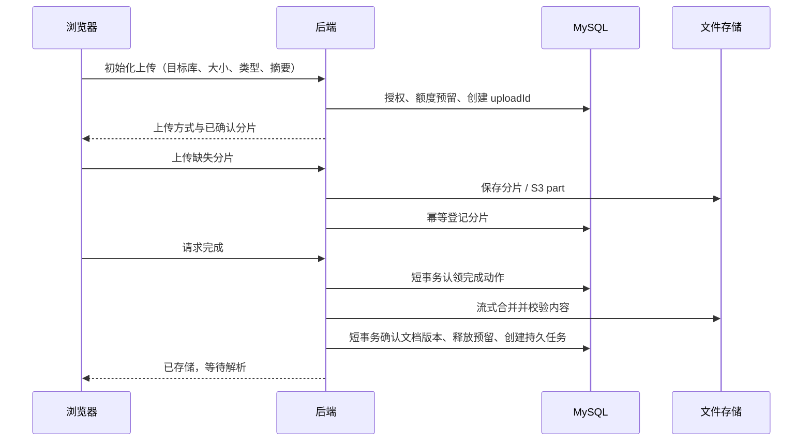

# 文档上传、处理与 RAG 开发方案

> 2026-11-09 设计草案，供讨论审核；除首版已上线能力外，下文均为规划，尚未实现或部署。本轮不修改 Java、前端、数据库、服务器及 Ashore，不执行 Git 提交。

## 1. 先确定目标与开发顺序

目标是尽快交付“上传自己的资料 → 看见处理结果 → 搜索 → 根据证据问答”的可展示作品。秒传和断点续传作为独立增强项，不能阻塞第一个真实文档问答闭环。

目前 v0.1.0 已有登录、个人区域、两份虚构模板预览、独立示例入库与正文读取；尚无文件上传、解析、Embedding、检索或问答。服务器已有 MySQL、Redis、ES，不代表 DocWeave 已接入全部组件。

建议顺序：

1. 上传、下载、列表和删除，先支持小文件。
2. 可靠异步解析、正文与段落，先不调用模型。
3. Embedding 与 ES 检索，建立固定小型评测集。
4. 带引用问答，真实走通 RAG 并部署。
5. 再补秒传、分片、断点续传等上传工程能力；若用户优先希望学习分片，可在第 1 步后单独插入这一阶段。

每阶段独立 Issue、分支、审核 MD、Apifox 契约和测试；PR/CI 通过并获授权后发布。开发用 docweave_dev，生产用 docweave_prod，不再按阶段保留一套长期审核库。

## 2. 各组件到底负责什么

| 组件 | 保存或处理什么 | 不承担什么 |
| --- | --- | --- |
| MySQL | 文件元数据、版本、归属、权限、任务、引用和会话 | 不保存原始二进制大文件 |
| 文件存储 / S3 兼容对象存储 | 原始 PDF/TXT/Markdown、临时分片 | 不决定用户访问权限 |
| Redis（按需） | 短期进度缓存、限速 | 不是上传完成与任务成功的唯一凭据 |
| ES | 文本片段、关键词索引、向量检索副本 | 不是权限权威源，也不是唯一原文存储 |
| Embedding 模型 | 把片段和问题转换为向量 | 不直接生成自然语言答案 |
| 问答模型 | 根据检索证据组织答案 | 不决定权限、不自行编造合法引用 |

上传成功、解析成功、可检索、可问答是四个不同状态，页面必须分别说明。

## 3. MinIO 是否要使用

### 3.1 建议结论

业务应依赖小而明确的 FileStorage 接口，提供写入、打开读取、检查、删除；不要把 MinioClient 散落到 Controller/Service。

结合快速交付目标，建议第一个上传版本使用 Docker 持久化文件卷，后续确实需要 S3 的 Multipart Upload/对象管理时接 S3 兼容实现。接口只先做当前需要的能力，不提前造通用存储平台。

这不是否定对象存储：如果明确希望把对象存储作为学习和简历重点，可以在上传阶段直接选定一个仍受维护的 S3 兼容服务或云对象存储，但这是尚待确认的选型，不是已部署事实。

### 3.2 为什么不直接照搬旧 MinIO

2026-11-09 查阅 [MinIO 官方仓库](https://github.com/minio/minio)，仓库已标为归档。旧项目的 MinIO SDK 和思路仍有参考价值，但新项目不能默认它仍是持续维护的社区部署方案。不能直接抄旧镜像标签并宣称长期生产可用。

若为学习复现 MinIO：单独确认可获取的固定版本、镜像来源和校验、兼容性及维护边界，再决定是否仅用于实验；本轮不下载或部署。暂不为了替代 MinIO 再引入多个候选服务比较和迁移任务。

### 3.3 环境隔离与下载

- 文件卷按 dev/prod 使用不同挂载目录；应用进程仅挂载本环境目录。
- 对象存储按环境使用独立私有 bucket 与凭据，服务端限制权限；仅名称前缀不同不等于权限隔离。
- 对象 key 使用组织/资源 UUID，不直接用原始文件名或客户端传入的路径；下载时还原经过清理的展示名。
- 首版由后端鉴权后代理下载，不开放 bucket 或文件目录，不要求新增公网存储端口。
- 后续如改为预签名链接，要明确它在过期前可能仍然有效，不能承诺撤权后立即失效；有立即撤权要求时继续代理下载。

## 4. 需要申请哪些模型服务

### 4.1 两种能力，不一定两个平台或两把密钥

Embedding 用于入库和问题检索；Chat 用于回答。两者分别配置 model、endpoint、key、超时和限额，同一平台也可以提供两种能力。只有问答 API 不能自动代替 Embedding API。

建议优先开通阿里云百炼的按量 API：Embedding 可评估 text-embedding-v4，Chat 可先使用账户实际可调用的通义模型，例如官方示例中的 qwen-plus。想使用 DeepSeek 回答，也可以 Embedding 保留百炼、Chat 单独接 DeepSeek。首轮只落实一家问答提供方，不先造多供应商自动路由。

模型名和可用区域会变化，实施时以控制台与官方接口为准，不把这些候选名写成已经确认的最终选型。

### 4.2 用户准备清单

- 开通相应平台、所需模型访问权限和计费，设置消费告警；不要假定免费额度一直存在。
- 获取项目专用 API Key，尽可能开发与生产分开；不给前端或公开 Apifox 变量配置真实 Key。
- 记录供应商、所在区域/业务空间对应的 Base URL、准确模型 ID、Embedding 支持维度、调用限额。
- 接入时通过私密环境配置提供密钥，不在聊天、Git、截图和审核 MD 中粘贴真实值。
- 上传阶段不需要这些 Key；开始向量化和问答阶段前准备即可。重排模型、OCR/VLM 都不是第一轮必须申请的服务。

百炼提供 API Key 与兼容接口，具体地址应从自己的区域/空间控制台取得，不抄一条其他区域地址后反复排错。官方入口：

- [获取 API Key](https://help.aliyun.com/en/model-studio/get-api-key)
- [通义首次 API 调用](https://www.alibabacloud.com/help/en/model-studio/first-api-call-to-qwen)
- [text-embedding-v4 模型信息](https://help.aliyun.com/en/model-studio/text-embedding-v4)
- [DeepSeek API 接入](https://api-docs.deepseek.com/api/deepseek-api/)

这些属于普通模型 API 接入方案，不能默认现有编程工具订阅或聊天产品会员就包含本项目所需的 Embedding/业务 API 额度。

### 4.3 维度与版本是数据契约

text-embedding-v4 官方文档提供多种维度选择；首版可评估 1024 维，最终需调用验证。ES dense_vector 的 dims 必须一致；问题与文档必须使用同一套模型版本、维度和预处理契约。

记录 provider/model/revision/dimensions/normalization 与 chunker_version；同维度的不同模型也不能混用。切换 Embedding 不能像聊天模型一样自动 fallback：需要重建新版本索引、验证后切换别名，保留回滚窗口。问答模型切换本身通常不要求重做已有文档向量。

PaiSmart 的 EmbeddingClient 有批处理、限流、超时、用量和版本信息，值得参考；其请求参数不能逐字照抄，例如 dimension/dimensions 等字段须按实际供应商协议映射并测响应维度及输入顺序。

## 5. PaiSmart 已核实的实现与取舍

本轮只读了旧代码和说明，不修改 PaiSmart。代码入口均相对于 PaiSmart 仓库：

| 已核实位置 | 事实 | DocWeave 如何借鉴 |
| --- | --- | --- |
| controller/UploadController.java | 上传分片、状态查询和合并入口，包含较多业务判断 | HTTP 层只校验格式并调用用例，不继续堆成胖 Controller |
| service/UploadService.java | MinIO 分片、合并、Redis Bitmap；按用户+文件 MD5 隔离与回源 | 使用 uploadId 任务隔离，MySQL/存储为准；缓存缺失可恢复 |
| model/ChunkInfo.java、repository/ChunkInfoRepository.java | 用户隔离分片记录 | 强制组织、上传人、目标知识库范围，不能只按文件 hash 查询 |
| service/reliability/FileProcessingOutboxService.java | 文件状态与 outbox 同事务，提交后投 Kafka，失败补发 | 保留持久任务与幂等思想；当前单实例先 DB worker，不先加 Kafka |
| client/EmbeddingClient.java | Embedding 批处理、超时、用量、模型版本；向量模型不自动换供应商 | 拆出协议适配，控制批次/并发/超时；不记录输入片段内容 |
| service/VectorizationService.java 与 index 相关模块 | 后续处理、索引和模型升级路径 | 处理阶段显式记录版本，索引可重建 |

另参考 docs/改造计划/01-上传模块分层改造说明.md：其中记录了浏览器按 5MiB 分片、合并后写 outbox，再交 Kafka 解析/向量化的旧主链路。该文档是历史说明，当前代码有后续修复，不将文档中的每条风险都当成尚未修复的现状。

需要区分：发现“状态查询/已有分片复用”不等于已证明旧系统具有安全完整的全局秒传。新的秒传契约独立设计、独立验收。

## 6. 秒传、去重与断点续传不是一件事

| 名称 | 用户感受到什么 | 实际条件 |
| --- | --- | --- |
| 同库重复提示 | 这份文件已经上传过 | 服务端确认同库已有可见、有效文档；不重复创建逻辑文档 |
| 普通上传后物理去重 | 上传完成后不多存一份字节 | 完整接收并校验后复用 blob；已经传过网络，不能叫秒传 |
| 秒传 | 几乎不再传文件内容 | 已有服务器验证的内容，当前用户仍有复用权限，目标库可写 |
| 分片上传 | 文件拆成小块，失败只重传部分 | 有稳定上传会话、分片编号与校验 |
| 断点续传 | 页面/网络中断后接着传 | 服务器保留有效会话和已确认分片；客户端重新选择同一文件后核验 |

浏览器刷新后不能保证还能自动读取本地文件，首版续传允许用户重新选择同一文件；不能承诺“关浏览器再开无需选择文件也自动恢复”。

### 6.1 秒传安全边界

先认证并校验目标库，再查询授权范围内可复用的已验证内容。建议首版只复用当前用户仍可下载的文件；跨组织全局秒传不做。

客户端 SHA-256 是查找线索，不是拥有文件或拥有权限的证明。不能根据一个 hash 返回其他组织文件存在性、文件名、大小或内容，更不能创建授权。旧文件已删除、源权限撤销、对象缺失或校验未完成时不走复用路径。

同库同 hash+size 已有活动文档时返回已有 documentId 和“重复”结果；跨库复用必须分别检查源可读、目标可写，并创建独立逻辑文档/版本引用。并发去重以数据库约束兜底，不靠进程内锁保证跨重启正确性。

### 6.2 推荐校验与分片参数（均为拟定值）

使用 SHA-256 + size，不沿用 MD5 作为完整性和授权依据。服务端对最终内容流式重新计算 SHA-256；S3 Multipart ETag 不能当作整文件 SHA-256。

增强版拟采用 8MiB 分片、并发 2、每片有界重试、上传会话 24 小时过期。S3 Multipart 实施时必须核对提供方的分片大小/数量限制，末片例外；旧方案 5MiB 只是历史值。

初始化上传会话后固定总大小、目标库、分片大小和预期片数；chunkIndex 从 0 开始、越界拒绝、仅末片允许短片。重复同索引同内容幂等成功，不同内容返回冲突。合并必须检查所有片的实际长度、总长和最终摘要。

### 6.3 上传会话流程

Redis Bitmap 仅为加速层；断点恢复从 MySQL 与实际分片/对象状态对账。Redis 清空不能把已上传内容“丢失”。不能只凭 Bitmap 的 1 就宣告文件完整。

对于第一轮小文件上传，省略分片步骤，仍遵守同样的权限、服务端摘要、幂等与补偿原则；不要为分片增强提前建立整套空表。

## 7. 数据模型与状态（规划，按需分阶段新增）

复用现有 organizations/workspaces/knowledge_bases/documents/document_versions；现有示例是数据库正文快照，不要求迁移成假二进制文件。

- file_blobs：组织范围内的内容标识、SHA-256、大小、storage key、可用/待清理状态；原文件名留在逻辑文档侧，不依赖对象名展示。
- document_versions 按阶段增加 blob 引用、解析版本、当前处理状态。保持已发布 V1～V3 不变，新增 V4 起；字段名/约束以实施设计为准。
- ingestion_jobs：文档版本、阶段、尝试次数、下次执行、租约持有者/截止时间、错误码。若任务重建，增加 generation，旧 worker 不能覆盖新结果。
- document_chunks：文档版本、页码/段落定位、原文、序号、内容摘要、切分版本。正文作为引用依据独立于增强检索文本。
- upload_sessions/upload_parts：仅在分片阶段新增，约束 uploadId+partIndex 唯一；uploadId 必须不透明、不可凭 hash 冒领。

建议把上传状态和处理状态分开，避免一个含义混乱的 status：

- 上传：UPLOADING → FINALIZING → STORED；另有 FAILED/CANCELLED/EXPIRED。
- 处理：PENDING → PARSING → CHUNKING → EMBEDDING → INDEXING → READY；另有 FAILED。
- 原有示例保持 NOT_INDEXED，只有真实完成索引并验证才转 READY。

状态名是提案，不是当前线上契约。文件已存但解析失败时保留原文件及失败原因，可以重试；不能把它当上传失败要求重复支付流量。

## 8. 一致性、删除和任务恢复

MySQL 和文件存储不能共用一个本地事务。不要把长时间上传/合并/模型请求放进数据库事务。

采用短事务记录预留/租约 → 存储 I/O → 短事务确认的流程。字节落盘后数据库提交失败，需要持久对账或带安全宽限期的孤儿清理；数据库标记完成却对象缺失时停止下载/处理，不返回假成功。完成请求允许按 uploadId/幂等键恢复与重试。

任务和文档状态同事务提交；单实例先 DB worker 轮询，带过期租约恢复与有界重试。不先引入 Kafka；未来接 MQ 时再用 outbox 可靠投递，消费仍需幂等。

删除先在 MySQL 标记文档不可用并撤销索引资格，后续异步删除 ES 内容和物理文件。所有下载、引用和检索返回都检查当前逻辑状态，不等待 ES 删除成功才生效。

复用物理 blob 不等于复用逻辑文档。删除一份文档只撤销这一份引用；最后一个有效引用、上传/任务租约均释放后才能回收 blob。不能只看容易漂移的引用计数；清理前在同一受控流程核实引用和状态。对象删除失败进入重试，不把生产对象目录整批清空。

过期会话应取消未完成 Multipart Upload、清理临时分片、释放额度；扫描后用户又上传的会话须用心跳/版本条件防误删。

## 9. 解析、检索和问答的最小闭环

### 9.1 文件限制

首版拟定 PDF（有文本层）、UTF-8 TXT、Markdown，20MiB/文件、单账号总量和日上传次数可配置。扩展名、声明 MIME、内容特征都要检查；空文件、超限、加密或损坏 PDF 返回可解释错误。扫描 PDF 明确提示暂不支持 OCR，不能解析空文本后显示成功。

解析要限制页数、字符数、耗时和内存；不得执行文档脚本或 Markdown HTML。文件名长度、路径和下载响应头都要清理。生产反向代理、Spring multipart 和业务大小限制一起调整，当前 Nginx 10m 不能原样承诺上传 20MiB 文件（还需预留 multipart 开销）。

### 9.2 文本切分

文件分片单位是字节，RAG 切片单位是文本段落/Token，两者完全独立。

先按标题/段落、PDF 页码组织，再按目标模型 tokenizer 或经过验证的估算限制切块；记录原文范围、重叠和切分版本，避免声称固定字符数就是 Token 数。为页码/段落建立可点击引用。首轮不接上下文增强、父子块扩展、OCR 多模态等全部高级策略。

### 9.3 索引与模型调用

ES dev/prod 使用不同索引前缀和角色，MySQL 已有隔离不能自动扩展到 ES。准备建索引时再核实既有 ES 的安全能力和当前版本支持，不擅自修改另一 Agent 的实例。

先以一小组文档对比关键词和向量召回，混合排序是否上线由评测决定；重排模型后置。所有搜索在召回前限制 tenant/workspace/可访问库，并对候选版本做 MySQL 权威复核，遵守现有 RAG 授权设计。

Embedding 批量数、单次 Token、超时、并发和每日预算都可配置；429/可重试服务错误做有界退避，余额不足/鉴权错误/非法文本不无限重试。失败后仅重做缺失且版本匹配的步骤，禁止简单重复全库向量化。

问答只把已授权且必要的片段发给供应商，不将全文、密码或无关聊天历史外发；文档内容作为不可信资料处理，不能修改系统指令或扩大工具权限。没有充分证据就说明资料不足。引用 ID 从服务端真实候选构建，校验模型返回的引用，不让模型自造 documentId。

先用非流式实现与现有授权契约一致的“模型前/返回前复核”，再做 SSE；不能为流式体验绕过撤权检查。对 10～20 个固定问题保留期望证据，包括同义问题、无答案问题、跨用户拒绝和删除后旧引用不可见。

## 10. 首轮接口提案与验收

以下路径是讨论用草案，实施时通过 OpenAPI 与 Apifox 固化，不表示已存在：

- POST /api/v1/knowledge-bases/{id}/documents：小文件 multipart 上传；鉴权、CSRF、幂等键、额度与服务端摘要。
- GET /api/v1/knowledge-bases/{id}/documents：复用现有列表，兼容新增上传文档状态。
- GET /api/v1/documents/{id}/download：本人有权访问的原文件；示例无原文件时明确说明，不伪造文件。
- DELETE /api/v1/documents/{id}：逻辑删除与持久清理任务，重复删除语义需固定。
- 后续再增加上传会话、分片状态、完成/取消、处理重试和搜索/问答接口。

首轮至少验证：正确上传下载的摘要一致；伪 MIME/超限/越权拒绝；并发重复与重试不重复创建；对象存储失败不会假成功；重启后元数据和文件都在；删除立即不可访问；开发与生产账号不能跨环境访问。

公开共享体验账号不能当成多用户隔离方案：共享账号天然共享资料。开放真实上传前明确独立账号准入或只读演示策略、配额和清理规则；当前闭合生产注册策略不因上传功能顺手放开。

## 11. 分阶段交付与停点

| 阶段 | 可验收产出 | 需要模型 Key？ | 本阶段不做 |
| --- | --- | --- | --- |
| A 上传闭环 | 自有资料上传、列表、原文件下载、删除、权限与补偿 | 不需要 | 分片、解析、问答 |
| B 解析任务 | 可看正文/来源位置、处理状态与失败重试 | 不需要 | OCR、向量、模型生成 |
| C 语义检索 | 向量入库、权限预过滤、可复现检索评测 | Embedding | 多模型混用、复杂重排 |
| D 证据问答 | 可提问、有依据、有引用、无证据拒答、用量限制 | Chat + Embedding | 全能 Agent、工具自主执行 |
| E 上传增强 | 授权范围秒传、分片与中断恢复、过期清理 | 不需要新增模型 | 跨组织全局秒传 |

每轮上线都要有数据库迁移记录、版本化产物、接口同步、实际浏览器/网络/数据库验证及回滚边界。不要把一份未来方案写成已完成的简历成果。

## 12. 待用户确认，不阻塞继续讨论

1. 是否接受先文件卷交付，再补 S3 兼容对象存储；若明确要求 MinIO 学习，则先确认维护与版本边界。
2. 模型是否优先百炼一站式；或者百炼 Embedding + DeepSeek Chat。
3. 优先尽快走通问答，还是在上传阶段先做分片/断点续传这一简历展示点。

默认建议是“文件卷起步、模型先一家、优先 RAG 闭环、分片独立增强”。这些仍是建议，未替用户执行模型开通、产生费用或部署新中间件。

## 13. 当前执行计划入口

用户已同意文件卷起步与后续上传工程化的方向。具体首轮范围、迁移、接口和审核停点见 [下一阶段开发任务与审核清单](05-下一阶段开发任务与审核清单.md)。模型供应商与 S3 产品尚未最终确定；用户审核任务单后才开发。
