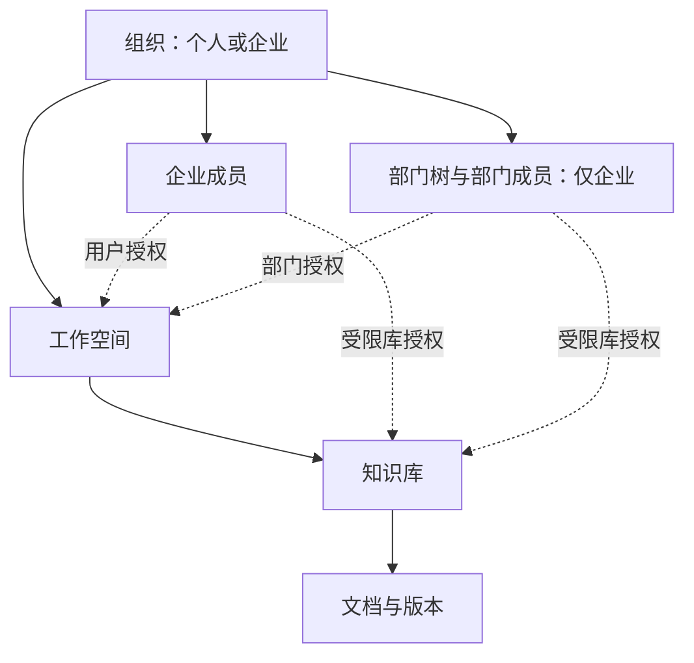

# 个人与企业场景及权限模型

> 状态：Issue #11 的设计提案，待人工审核；不是当前系统已实现的能力。
> 适用范围：个人知识管理、企业内部知识协作与 RAG。首版不提供跨组织共享、匿名内容访问或外部客户账号；登录后的个人试用与企业演示均纳入规划。

## 1. 产品场景与术语

DocWeave 既服务个人知识管理，也服务企业成员在授权范围内查询制度、部门知识和项目资料。文档数量只是背景之一，知识更新、协作、访问控制和证据追踪同样构成业务价值。

| 概念 | 含义 | 边界 |
| --- | --- | --- |
| 组织（tenant） | 个人区域或一家企业，类型为 PERSONAL / ENTERPRISE | 数据隔离的最外层边界；代码中的 tenant_id 不只表示公司 |
| 账号（user） | 登录身份 | 一个个人组织，可另被邀请加入多个企业；每次业务请求只选择一个组织 |
| 组织成员（membership） | 账号在某组织中的身份、角色和状态 | 组织停用或成员离职优先于全部内容授权 |
| 部门（department） | 企业内部的组织树 | 表达人员归属，不直接赋予内容权限 |
| 工作空间（workspace） | 个人资料区域或企业协作区域 | 属于一个组织；企业空间可由多个部门共同参与 |
| 知识库（knowledge base） | 使用相同内容权限的一组资料 | 属于一个工作空间 |
| 文档（document） | 业务资源及其版本 | 属于一个知识库；首版完整继承知识库权限 |

部门树与内容树分别建模；没有“部门必须拥有唯一空间”的约束。

### 1.1 个人模式与企业模式

| 模式 | 使用体验 | 管理规则 |
| --- | --- | --- |
| 个人 | 我的知识库、文档和问答；不要求填写公司或部门 | 一个账号最多一个个人组织，仅自己一个成员；首版不邀请他人、不转移所有者 |
| 企业 | 企业成员、部门、跨部门项目和知识授权 | 通过邀请加入，组织角色与内容角色分开 |
| 企业演示入口 | 进入有虚构部门、角色和非敏感资料的演示企业 | 不是新的组织类型；展示内容只读，聊天仍按登录账号隔离 |

账号首次注册时，在同一事务建立个人组织、OWNER 成员、默认“我的资料”空间和该用户的直接空间 ADMIN 授权；不依赖硬编码所有者旁路。初始化幂等、并发注册唯一性与失败回滚需要测试。M1 尚无知识库功能时，界面如实显示待开发状态。

后端对个人与企业执行相同的组织隔离。个人界面隐藏组织成员、部门、复杂授权等入口；服务端也禁止个人组织邀请成员或创建部门，不能只隐藏按钮。个人组织中只允许所有者操作自己的资料，不能枚举其他用户的个人组织。

一个人加入两个企业，可能是顾问、外派、集团协作等场景，不是默认要求；只有存在多个可用组织时才展示切换入口。公司退出或成员停用不删除个人账号，也不影响其个人组织。

### 1.2 求职展示与试用入口

- 个人试用：用户以独立账号登录，上传和聊天均在自己的个人组织中；不进入其他试用者的区域。
- 企业演示：向独立体验账号发放受控的演示企业阅读资格；预置资料只读，不允许向公共演示库上传、删除或修改授权。需要体验上传时跳转个人区域。
- 不提供多人共用且可写的管理员账号。演示企业成员不能查看他人聊天；切换展示角色如后续开放，只能在隔离演示环境中使用固定的演示范围，不能任意扮演真实用户。
- 公开注册前落实注册、文件、模型调用等配额与限流；具体阈值在对应实现 Issue 确定。企业功能受控开放不等于关闭个人试用，未完成个人功能时也不能宣传为可用。
- 不支持匿名内容访问；演示仍须识别访问者身份。企业创建及初始管理员入口保持受控。

下文的部门、入离职和企业治理规则适用于 ENTERPRISE；内容角色、知识库规则与 RAG 隔离同样适用于个人组织。为便于阅读，后面的企业案例仍使用“公司”称呼。

### 1.3 跟着小林走一遍

1. 小林注册账号，拥有只属于自己的“我的资料”区域，其他体验者看不到。
2. 星河科技邀请小林加入，他在公司被分配到后端组；他的个人资料不会自动变成公司资料。
3. 公司制度空间授权给全体有效成员，小林自动可读，不用管理员逐个添加姓名。
4. 商城项目空间只授权给项目参与人，小林与销售同事小周都可加入，部门不需要改变。
5. 薪酬库仅授权财务，小林即使进入公司协作空间也不能读；上级老陈也不能凭职位绕过授权。
6. 某个库把小林加入排除名单后，其他允许授权不能覆盖排除，AI 也不能替他检索该库。
7. 小林离职，公司成员身份停用，公司资料不能继续访问；个人账号和个人资料保留，公司共享文档也不会跟着他被删除。



首版采用同库同表、显式 tenant_id 隔离的应用模型，不意味着已具备独立数据库或基础设施级隔离。平台运维人员的数据库访问能力与应用内权限是不同的信任边界。

## 2. 四个可演示业务案例

示例企业“星河科技”包含研发部（后端组、前端组）、销售部和财务部；另有完全隔离的“远山科技”。

| 场景 | 空间与知识库 | 授权方式 |
| --- | --- | --- |
| 公司制度 | 公司协作空间 / 员工制度库 | 空间授予企业全体在职成员 READER；知识库继承 |
| 部门共享 | 研发空间 / 研发规范库 | 空间授予研发部及子部门 READER，指定维护人 EDITOR；库继承 |
| 跨部门项目 | 客户交付空间 / 项目资料库 | 仅明确加入的研发与销售人员获得空间角色；库继承 |
| 敏感资料 | 公司协作空间 / 薪酬制度库 | 库切换 RESTRICTED，仅指定财务成员或部门获得库角色 |

最后一个案例刻意让普通资料和敏感资料位于同一空间，用于验证“能进入空间，不等于能看所有知识库”。未授权用户看不到受限库的名称、文档标题、数量或搜索摘要。

## 3. 部门与上级的规则

- 首版同一企业成员最多归属一个部门；入职待分配时可以暂不属于部门。账号在不同企业可以各有一个所属部门，个人组织没有部门。
- 部门成员必须先是同企业的有效成员；通过唯一约束限制一个企业成员只有一条部门归属，调岗以事务替换关系。跨部门项目通过空间授权解决，不把项目成员误当作兼属多个部门。
- 对部门授权必须明确选择 SELF（仅该部门）或 SUBTREE（该部门及所有子部门）。默认 SELF。
- SUBTREE 的含义是向下展开被授权部门的成员。例如研发部及子部门可读，不表示后端组文档自动向所有上级开放。
- 职位、直属上级、部门负责人身份不自动获得文档阅读权。首版不实现汇报关系授权。
- 上级需要阅读时，获得与其他成员相同的明确授权；不默认读取员工个人问答历史。
- 调岗、部门停用、组织树移动均重新计算范围；部门树禁止跨企业父节点和环。

## 4. 角色与内容授权

### 4.0 RBAC 与资源范围，用小林的例子理解

RBAC 是“用户分配角色，角色拥有操作权限”。本项目使用角色管理操作能力，再通过具体组织、空间和知识库上的授权确定范围，不只在用户表保存一个全局角色。

```text
小林 → 商城项目空间的 EDITOR → 可读、上传、编辑和删除该范围内的文档
小林 → 公司制度空间的 READER → 可读和问答，不可修改制度
小林 → 薪酬知识库无授权 → 不可读，也不能让 AI 代读
```

部门用于批量选择授权对象，本身不自动赋权；后端负责人也不能凭职位读取未加入的项目。角色继承（EDITOR 包含 READER 的操作）与公司的上下级关系是两回事。

授权的资源粒度首版到知识库，授权对象最细到个人；文档继承所在知识库权限。需要不同权限的两份文件应放在不同知识库，暂不做逐篇文档例外。

### 4.1 企业角色

| 角色 | 可以做什么 | 不自动获得什么 |
| --- | --- | --- |
| OWNER | 管理企业、转移所有者、任命企业管理员 | 全部空间和受限库的阅读权 |
| ADMIN | 管理企业成员、部门和停用状态 | 全部文档、成员聊天记录的阅读权 |
| MEMBER | 使用已获授权的空间和知识库 | 其他成员的资源与管理能力 |

企业创建者被显式授予初始空间 ADMIN；这是一条可审计授权记录，不是判断 owner_id 就绕过所有权限。企业普通成员不能自行创建空间，首版由 OWNER / ADMIN 创建并指定初始空间管理员。

空间管理员负责日常空间授权和归档；归档不物理删除内容。首版不开放整个空间的永久删除接口，不能用删除空间绕过受限库保护。个人模式由本人持有显式管理角色，可管理自己的空间，最后一个默认空间不能在缺少替代入口时被归档。

### 4.2 空间角色与继承库角色

| 空间角色 | 空间操作 | INHERIT 模式知识库的角色 |
| --- | --- | --- |
| READER | 查看获授权的空间入口 | READER：读取、检索、问答、预览和下载 |
| EDITOR | 同 READER | EDITOR：另可上传、创建版本、编辑和删除库内文档 |
| ADMIN | 管理空间信息与空间授权，创建知识库 | MANAGER：另可管理知识库配置与授权 |

知识库角色为 READER、EDITOR、MANAGER，依次包含前者能力。下载与读取首版使用同一权限；禁止下载但允许问答不属于当前范围。

### 4.3 知识库两种模式

- INHERIT：只使用空间角色映射，不维护额外库授权。
- RESTRICTED：忽略全部空间角色映射，只使用库的显式授权；进入空间仍是必要前提。空间 ADMIN 没有隐含例外。
- 允许授权对象支持有效组织成员，以及企业模式下的部门和全体成员；受限库不支持“企业全体成员”允许授权。多个允许来源先取最高角色，再应用下述知识库人员排除；不实现任意 deny 表达式或逐篇文档例外。
- 空间 ADMIN 可创建新的受限库，事务内为指定的有效空间成员写入直接用户 MANAGER 授权。已有 INHERIT 库收紧为 RESTRICTED 时，操作者须已有该库 MANAGER 权限，同一事务完成模式与初始授权变更。不能先切模式再异步补管理员。
- 库已有受限权限时，空间 ADMIN 不能修改其授权、放宽模式、删除该库或删除整个空间来绕过限制。修改受限库授权、模式或删除库需要该库 MANAGER；空间归档不物理删除库数据。
- 收紧或放宽权限均显示受影响范围并审计；RESTRICTED 库不能移除最后一名有效的直接用户 MANAGER，必须先完成交接。INHERIT 库的管理者保护见 4.5 节。
- 不能通过部门移除、企业成员停用规则强行维持已离职人员权限。出现无人可管理的受限库时保持封闭，进入恢复流程，不能自动变为全员可见。

空间 ADMIN 管空间授权，库 MANAGER 管库授权，READER / EDITOR 不能授予或提升角色。受限库授权对象仍须满足空间入口条件；部门授权与空间授权取交集，不能靠库授权直接进入一个无权空间。界面应说明未覆盖到空间的部门成员并不会因此获得访问权。

空间同样保留至少一名有效的直接用户 ADMIN，授权编辑不允许删除最后一名。成员停用或其他身份变更优先执行，导致失管时保持封闭，不自动把企业管理员升级为空间管理员。

管理与内容分离限制日常操作，但不是抵抗恶意企业控制者的绝对保密机制：管理员能调整部门成员，授权管理者能主动授予他人权限。此类操作必须审计。首版不提供通用“超级管理员阅读”接口；受限库失管后的恢复需后续单独设计审核流程，不能暗中放行。

### 4.4 统一判定

```text
允许某操作 =
  账号有效 AND 组织有效 AND 当前组织成员有效
  AND 资源属于当前组织 AND 资源祖先关系与状态有效
  AND 空间有效角色满足入口要求
  AND 当前成员不在知识库排除名单
  AND 知识库有效角色满足该操作要求
```

纯企业管理操作按企业角色判断；没有内容的管理页面只返回必要管理元数据。未授权内容按不存在处理（404），未登录返回 401；在可见资源上缺少操作权限返回 403。列表、统计、搜索、导出使用相同范围，不能先查全部再让前端隐藏。

客户端传来的 tenant_id 只用于选择企业，不是授权凭据。服务端核对成员后建立当前企业上下文；资源查询必须带企业条件。文档作者身份和创建者字段不额外授予访问权；退出企业后也不能继续访问自己曾经上传的企业文档。

### 4.5 “所有人可见，但排除几个人”与动态成员

新增一项范围有限的规则：企业知识库支持排除具体成员，INHERIT 和 RESTRICTED 两种模式均适用。排除表示该成员不能访问整个库，不只是不能下载；阅读、列表元数据、搜索、问答、上传、删除、引用及历史来源检查全部受影响。

优先级固定为：账号/组织/成员无效 → 拒绝；命中库排除 → 拒绝；否则再判断空间入口与库的允许角色。用户直接、部门、全员甚至管理角色的允许都不能覆盖排除；模型、缓存和运维身份没有应用内旁路。

只有当前具备该库 MANAGER 权限且未被排除的人能编辑排除名单；INHERIT 库由空间角色映射得到 MANAGER。不能通过排除、删除授权或切换模式造成无人可管理：INHERIT 至少保留一名未被排除且由直接用户空间 ADMIN 映射的管理者，RESTRICTED 至少保留一名有效的直接用户 MANAGER。权限事务校验并记审计。成员离职/停用仍优先执行，失管时按封闭和恢复规则处理。移除排除不等于授予权限，只是恢复对其他允许来源的正常计算。

例如员工制度库继承“全体有效成员可读”，但将小林加入排除名单：新入职员工加入企业后自动可读，小林即使仍在后端部也不能读。移除小林的排除后，他通过全员授权恢复阅读。用户界面应解释“全员允许，但库排除优先”，避免只显示一个模糊角色。

部门授权随入职分配、调岗实时变化；项目授权按参与人员动态增减。离职使用企业成员停用，不逐个写入所有库的排除名单。成员重新启用不清空原排除；成员记录保留并重新审核，不能用重新加入绕过原排除。

个人组织不提供排除自己的操作；只有本人一个成员，没有“排除其他同事”的需求。

## 5. 案例权限矩阵

下表“有权”只指读取；所有账号有效且处于当前企业。“企业管理员”示例没有获得额外空间或库授权。

| 用户 | 员工制度 | 研发规范 | 交付项目 | 薪酬资料 | 他人聊天 |
| --- | --- | --- | --- | --- | --- |
| 后端员工小林，交付项目成员 | 有权 | 有权 | 有权 | 无权 | 无权 |
| 销售员工小周，交付项目成员 | 有权 | 无权 | 有权 | 无权 | 无权 |
| 研发负责人老陈，未加入项目 | 有权 | 有权 | 无权 | 无权 | 无权 |
| 财务成员小许，受限库 READER | 有权 | 无权 | 无权 | 有权 | 无权 |
| 仅有企业管理角色的管理员 | 有权 | 无权 | 无权 | 无权 | 无权 |
| 远山科技成员 | 无权 | 无权 | 无权 | 无权 | 无权 |

移除一个直接授权不一定撤销最终权限：若仍有部门或全员授权，用户依然可读。授权界面应显示有效权限来源，撤权接口和测试均以最终有效权限为准。

## 6. 逻辑数据模型与约束

以下是职责与约束草案，不是一次性建表清单。表随对应功能的 Flyway 迁移加入。

| 数据 | 关键字段与约束 |
| --- | --- |
| users | 登录身份、密码哈希、账号状态；全局唯一标准化账号标识 |
| tenants | 组织名称、类型 PERSONAL/ENTERPRISE、状态、authz_version；每个账号最多一个 PERSONAL |
| tenant_memberships | tenant_id、user_id、角色、状态；企业与用户唯一 |
| tenant_invitations | 企业、邀请令牌哈希、目标身份约束、有效期、使用状态与邀请者；消费与加入成员在同一事务完成 |
| departments | tenant_id、parent_id、状态；父节点同企业、禁止环 |
| department_memberships | 企业成员与部门关系；双方同企业，企业成员 ID 唯一，实现最多一个所属部门 |
| workspaces | tenant_id、名称、状态；创建者只作审计 |
| workspace_grants | 空间、授权对象、部门范围、空间角色 |
| knowledge_bases | tenant_id、workspace_id、访问模式、状态 |
| knowledge_base_grants | 受限库、授权对象、部门范围、库角色 |
| knowledge_base_exclusions | 企业、知识库、被排除成员；同企业关联、库与成员唯一，只表达整库拒绝访问 |
| documents / document_versions | tenant_id、知识库、文档 ID、版本、状态、对象键和内容校验值 |
| conversations / messages / evidence | 企业、空间、会话所有者、消息以及实际使用的文档版本依赖 |
| audit_events | 企业、操作者、动作、对象、授权变化、结果、requestId 与时间 |

授权表的对象类型不能只靠自由字符串拼接。实现时采用有外键约束的用户/部门列及对象类型约束，防止悬空或跨企业授权；全员授权使用明确枚举。唯一约束覆盖对象、资源及部门范围，避免重复授权。

父子表需用同企业复合关联等数据库约束防止错误引用；Service 同时校验租户和成员状态。实际 DDL 在对应 Issue 中确认，不能只靠 Repository 方法名保证隔离。

文档 ID 表示业务资源，内容哈希只用于校验和重复上传检测。ES 文档键、对象存储路径和任务键必须包含组织及文档版本范围，禁止用全局 MD5 直接代表业务所有权。首版不同业务文档独立保存对象，不做跨文档物理去重，更不能跨组织共享可删除的存储对象。

企业归属不可通过普通更新接口修改；首版不提供知识库跨空间迁移或文档跨知识库移动，后续若加入需作为权限变化重新设计。资源归档后不参加普通内容访问与检索，管理元数据按独立管理权限提供。

M1 实现账号、个人组织初始化、企业成员、部门、空间及空间授权和审计必需部分；知识库、库授权及排除随 M2 加入，文档、检索和历史表更晚加入。

### 6.1 重复上传、版本与删除的明确行为

| 场景 | 首版行为 |
| --- | --- |
| 同一知识库重复上传字节相同的可用文档 | 检查权限后提示已存在并返回已有文档，不重复创建资源或索引；并发请求也不能生成重复资源 |
| 文件名相同、内容不同 | 不自动覆盖；让有权编辑者选择创建新版本或另存为独立文档 |
| 相同内容上传到另一个知识库或组织 | 建立独立业务文档和存储对象，采用目标库权限，不透露其他库或组织是否已有该内容 |
| 两个人使用同一库中的同一个文档 | 这是公司共享资源，不是各自副本；有权编辑者删除会影响所有使用者，必须明确提示 |
| 删除一份独立文档 | 仅影响其自身版本、索引、预览与状态，不按全局哈希清理其他文档 |
| 上传者离职 | 文档仍属于原组织，上传者不再访问；不因离职自动删除企业资料 |

同库相同内容的识别以内容校验值及必要的内容一致性验证为准，不以文件名为准。检测必须限制在当前可读范围，不能通过“已存在”提示泄露其他受限资料。文档及版本并发唯一性、幂等与恢复行为随 M2 明确 DDL 并测试。

M2 首先采用逻辑删除：立刻停止检索与下载，索引等副本异步清理但仍受权威状态拦截；首版不开放永久清理或回收站恢复入口。被逻辑删除的文档不参加可用文档重复检测，重新上传可建立独立资源；旧任务和旧引用不能因此自动复活。

以后若加入物理去重，需要引用计数、并发安全和最后引用清理机制，作为独立设计；回收站恢复、保留期限和彻底清理也需单独验收，不能假定逻辑删除已释放所有存储。

## 7. 企业加入、离职与治理

- 注册建立个人组织，不等于加入某家企业，也不自动授予公司知识；首版通过企业内邀请加入，邀请绑定企业、一次使用、有有效期，令牌只存哈希。
- 公开演示的企业创建和邀请发放需限制，首个企业通过受控初始化建立；不得公开无保护的管理员初始化接口。
- 企业角色与空间角色分别授予；邀请默认企业 MEMBER，不接受客户端自报 ADMIN。
- 成员停用优先于全部授权，并在同一事务提升企业授权版本；最后一名 OWNER 不能被普通成员管理操作移除。
- 权限变更和关键管理事件持久审计，首版不依赖全文业务日志充当审计记录；不记录密码、完整邀请令牌或正文。
- 企业归档保留数据并拒绝业务访问，物理删除和合规保留后续单独设计。

## 8. 参考与旧项目取舍

PaiSmart 静态代码参考：User 的 orgTags/primaryOrg 和 USER/ADMIN；OrganizationTag.parentTag；OrgTagCacheService.getUserEffectiveOrgTags 向上收集父标签；FileUploadRepository.findAccessibleFilesWithTags 与 HybridSearchService.buildPermissionFilter 的本人/公开/组织 OR 条件。上述事实不是运行时权限测试结论。

保留“检索时过滤、文件操作检查归属”的思路；不沿用把私人区域、企业、部门混在标签字符串中、全局 public 放行或不同入口分别定义权限的方式。

安全原则参考 [OWASP Authorization Cheat Sheet](https://cheatsheetseries.owasp.org/cheatsheets/Authorization_Cheat_Sheet.html) 的默认拒绝、最小权限及每次请求检查。角色矩阵与继承策略是本项目提案，不是该资料指定的唯一实现。

RBAC 概念参考 [NIST RBAC 介绍](https://csrc.nist.gov/projects/role-based-access-control)：用户取得角色、角色包含操作权限。本项目另外限定组织与资源范围，并加入有限的知识库人员排除，不是照搬一个全局角色表。

后续阅读：[RAG 授权与撤权设计](02-RAG授权与撤权设计.md)、[个人与企业 M1 计划](../开发规划/03-M1账号与工作空间实施计划.md)。
