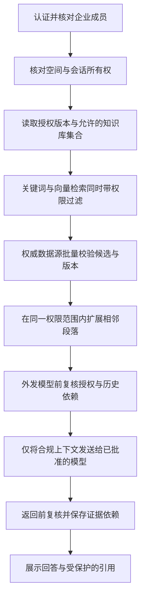

# RAG 授权与撤权设计

> 状态：Issue #11 的设计提案，待审核；检索、聊天、索引与撤权能力尚未实现。
> 前置规则：[企业场景与权限模型](01-企业场景与权限模型.md)。本文规定后续模块必须共同满足的安全契约。

本文中的 tenant_id 统一表示组织，适用于 PERSONAL 个人组织与 ENTERPRISE 企业组织；下文“企业”指企业模式的业务案例。个人模式也执行组织、成员、空间和内容授权检查，不因只有一个人就跳过隔离。

## 1. 什么必须在模型之外完成

企业和成员身份、可访问知识库、资源状态和授权由后端判定。用户问题、文档内容、提示词和模型输出都不能改变访问权限；“请只回答有权限的信息”不能替代服务端检查。

首版一次会话限定一个企业和一个工作空间，可查询其中多个有权访问的知识库。切换企业或空间创建新会话，不复用旧会话上下文。首版不支持会话分享和跨空间问答。

## 2. 一次问答的数据路径



授权信息不可获得、数据库异常或版本冲突不能解决时，停止该请求并返回安全错误，不能降级为不带过滤的全文或向量查询。

## 3. 检索过滤与权威校验

MySQL 是成员、权限和资源状态的权威来源；ES 是可以重建的内容检索副本，不是新的授权事实来源。

授权服务在当前组织读取有效成员、空间角色和知识库策略，先计算允许角色，再剔除命中知识库人员排除的库，得到最终允许的 knowledge_base_id 集合。没有可访问库直接返回空结果；客户端传来的库 ID 只能缩小集合，不能扩大。排除不是检索完成后的显示选项，也不能被 ADMIN/MANAGER 角色覆盖。

每一路召回至少携带：

```text
tenant_id = 当前组织（个人或企业）
AND workspace_id = 当前空间
AND knowledge_base_id IN 当前允许集合
AND 索引记录标记可用
```

关键词查询、KNN 预过滤、降级查询、重排输入和统计结果都需要遵守同一范围。禁止先从全库取 Top K 后仅靠末尾过滤：这既可能泄露，也会使允许的结果被无权候选挤占。

ES 候选的 chunk_id、document_id、document_version_id 与完整归属必须在 MySQL 批量校验。只有当前可用文档版本及其合法片段可以进入上下文；未知、已删除、失效版本或归属不符的候选丢弃。索引陈旧导致结果暂时缺失可以接受，越权内容不能返回。

相邻切片、父段落、表格和图片扩展必须使用同企业、同文档、同版本的业务 ID，并继续验证访问资格，不能用 content_hash 全局查找相关内容。

首版文档继承知识库权限，因此优先使用权威计算的库 ID 过滤，不把每个用户名单复制到所有切片。企业授权版本用于检测快照失效，不要求把整个企业版本号同步进每个 ES 文档才能查询。未来若增加文档级例外，必须同时修改此过滤契约、授权校验与回归用例。

## 4. 授权快照与撤权时序

组织维护单调递增 authz_version，成员、角色、部门关系、部门树、空间授权、知识库模式、允许授权或人员排除变化，在同一数据库事务递增该版本。通过一致性读取或“读取版本—计算—复读版本”得到稳定快照；并发修改时有界重试，不能无限循环。

账号全局停用不只影响一个企业，因此账号有效状态须另外实时核验；不能只看某个企业版本。资源删除、归档和版本切换也须在候选、返回和下载等边界核对当前状态。

| 时点 | 动作 |
| --- | --- |
| 请求开始 | 核验账号、企业与成员；计算空间、库权限及快照版本 |
| 模型调用前 | 重新核对有效身份、版本和所有上下文依赖；变化则重新判定，无法安全重建就中止 |
| 回答返回前 | 再次核对；若任一实际来源已失权，整条待返回回答不发送 |
| 打开历史、引用、预览、下载或缓存 | 按当前权限重新核验，不能使用生成时的允许结果代替 |

首版 M5 优先使用服务器缓冲完整答案，完成返回前复核后再发送。真正的逐 token 流式输出安排为后续独立改动，必须定义检查频率、撤权时取消、断连及部分回答保存策略后才能启用。

撤权语义：撤权事务提交后开始的新请求，必须使用新权限；执行中请求在下一授权检查点检测变化并停止后续发送。已经发给模型、进入网络或展示在浏览器的字节无法撤回；不承诺撤权与外部网络发送具有跨系统原子性。界面、接口和验收不能宣称“立即抹除全部已泄露内容”。

企业版本号方案适合初期规模；大企业频繁权限变动可能导致大量请求重试。后续可细化到成员或资源版本，先保持正确性，避免过早实现分布式权限引擎。

## 5. 历史回答本身也是受保护数据

只隐藏失权引用是不够的：回答正文、会话标题和摘要可能已经包含原文内容。

- 会话属于企业、空间和创建者；企业 ADMIN、上级和同空间其他成员不默认查看。
- 每条回答保存实际送入模型的全部来源依赖（文档、版本、必要片段），不是仅保存模型最后引用的几个链接。
- 多轮问题使用历史回答、摘要或改写结果时，累积其来源依赖；未逐句标注的答案按完整依赖集合保护。
- 再次读取时先检查会话归属，再检查企业、空间、来源库当前权限和资源状态。任何依赖不再可读，首版隐藏整个相关问答轮次，返回通用“来源权限或状态已变化”提示。
- 自动生成标题与摘要有独立依赖；依赖失效时标题使用通用名称，摘要不可返回。相同规则用于会话列表、导出和浏览器搜索。
- 继续对话时禁止将已隐藏轮次或旧摘要送入模型；首版要求重新提问，不让模型自动“清洗”旧答案。
- 权限恢复也不能绕过文档版本已删除或来源依赖缺失的检查。无法证明安全的历史答案默认隐藏。

普通检索只召回当前发布且可用的文档版本；历史引用则可以指向仍保留且允许访问的旧版本，发布新版本本身不使历史失效。旧版本被删除、撤下或所属资源失权时，按上述隐藏规则处理，不能把引用悄悄替换为新版本却保留旧答案。

用户主动输入的内容也可能含敏感资料；首版不分享会话，不将用户问题转成全企业知识。删除、保留期限与企业治理属于独立需求。

### 5.1 谁能查看聊天，以及如何排障

| 身份或用途 | 默认允许范围 |
| --- | --- |
| 本人 | 查看自己的会话；回答及引用仍需通过当前来源权限检查 |
| 同事、负责人、企业管理员 | 不默认查看他人聊天，不能凭职位或管理角色绕过会话所有权 |
| 平台运维 | 通过 requestId、耗时、错误码、状态和脱敏异常排障；没有应用内的全量聊天浏览权限 |
| AI 多轮上下文 | 只接收当前组织、空间和会话中仍有权使用的必要历史；不能读取全公司聊天 |

首版不开发运维浏览聊天正文的后台。未来若需要内容级诊断，应通过用户主动选取会话并明确授权的临时访问机制，限定人员、范围与期限并审计，不能默认开启。数据库与备份的运维访问另由受控基础设施权限管理，不声称应用校验能限制持有数据库高权限的人。

例子：小林可以看自己的报销问答，老陈不能因为是小林上级就读取；小林退出商城项目后，自己旧回答中的商城来源也会被重新检查。排障人员先通过 requestId 定位错误，而不是先导出小林所有聊天。

## 6. 引用、预览和文件下载

- 引用指向稳定业务 ID 和文档版本，服务端每次解析并授权；ID 难猜不是安全机制。
- 模型返回的引用编号只能映射到本次实际提供的证据白名单；未知编号或伪造资源 ID 不自动解析为新的文档访问。
- 未授权时不返回标题、原文、路径、页图和存储地址；同一库中的片段与原文权限一致。
- 对象存储私有；首版通过后端授权后代理下载，不向浏览器暴露长效直链。
- 如以后使用预签名 URL，须明确短有效期内无法逐次撤权的限制，另做评审；不能沿用首版代理下载的撤权承诺。
- 预览图片、PDF 单页、OCR 输出和解析文本都是衍生内容，继承原文权限。
- 不把敏感响应交给公共 CDN 缓存；浏览器内容响应采用合适的 private/no-store 策略。退出和切换企业清除前端内存中的内容状态。

## 7. 缓存与异步任务

### 缓存

首版不增加跨用户答案缓存。未来缓存检索、摘要或答案时，键至少区分企业、用户、空间、授权版本、查询及模型/内容版本，命中后仍核验身份和资源状态。

缓存清除消息只能辅助提速，不能作为唯一撤权保障。权限变化提交而清除消息丢失时，权威版本检查仍必须拒绝旧权限。读取不到权威数据不能使用旧允许结果续命。

### 上传、解析与索引任务

任务携带 tenant_id、document_id、document_version_id、处理代次和执行身份；不长期保存用户 JWT，也不信任消息自带的授权结论。

上传和重新处理入队前核验操作者权限。后台执行通过受限服务身份处理企业已接收的资源，执行前核验企业、资源状态、当前代次和任务资格；上传者退出不自动取消企业已经接收的文档，但停用企业或删除资源应使任务取消。

权限变化不由旧任务重新写回；任务只能写内容及处理状态，不能恢复旧 ACL。以版本和处理代次做幂等与条件更新，防止文档删除后迟到的处理结果重新可见。对象、索引和缓存全部使用企业及文档版本范围内的键。

## 8. 外部模型、审计与内容边界

阅读权限不等于企业批准将资料发送给任意外部服务。企业需明确允许的嵌入、重排、OCR 和生成供应商、数据使用约定及密钥配置；没有配置允许的服务时关闭对应能力。首版不允许用户通过问题指定任意外发地址，也不默认用敏感资料作为演示数据。

文档内容视为不可信数据，不能执行其中的“忽略权限”“调用某地址”等指令。模型工具也使用后端的当前企业上下文与授权检查，不能由模型传入任意用户身份。

授权变更和访问拒绝记录 tenant_id、操作者、资源、动作、结果、授权版本与 requestId。企业内可见的审计界面须限制访问，且不包含未获内容授权的正文、标题或聊天内容。完整提示词、回答、向量与邀请令牌不进入常规日志。

## 9. 可执行验收矩阵

这些是后续各里程碑必须实现的测试场景，不代表本轮已运行。

| 编号 | 场景 | 必须证明的结果 | 阶段 |
| --- | --- | --- | --- |
| A01 | 企业 B 成员伪造企业 A 与资源 ID | 列表为空或资源 404，无任何内容元数据 | M1/M2 |
| A02 | 负责人未加入下属项目 | 项目资料不可见，无上级身份旁路 | M1/M2 |
| A03 | 部门 SELF 与 SUBTREE 授权 | 两种范围产生不同且正确的成员集合 | M1 |
| A04 | 用户同时有个人与部门授权，移除前者 | 后者仍有效；界面可解释权限来源 | M1/M2 |
| A05 | 空间 ADMIN 未获受限库角色 | 无法阅读、放宽或删除受限库 | M2 |
| A06 | 员工离职但登录凭据尚未过期 | 新请求被拒绝，旧缓存不能恢复资格 | M1 起 |
| A07 | ES 保留撤权、归档或删除前的记录 | 候选在进入模型前被剔除，供应商请求不含该片段 | M4/M5 |
| A08 | 向量服务失败降级关键词检索 | 降级仍带相同企业与库范围 | M4 |
| A09 | 在召回后、模型调用前撤权 | 不外发失权上下文 | M5 |
| A10 | 模型生成期间撤权 | 返回前检测，整个待返回答案不发出 | M5 |
| A11 | 撤权后重开旧历史或继续对话 | 失权轮次、摘要与标题不泄露，下一次模型调用不含旧内容 | M6 |
| A12 | 同内容不同企业上传、其中一方删除 | 另一方资源与索引不受影响 | M2/M4 |
| A13 | 删除后旧解析任务迟到 | 任务不能复活文档或恢复权限 | M3 |
| A14 | 引用预览和下载使用旧链接 | 重新授权，拒绝失权内容 | M2/M5 |
| A15 | 权威数据库或授权版本读取失败 | 安全失败，不返回旧允许结果或启动无过滤检索 | 各阶段 |
| A16 | 全员允许但指定成员被库排除 | 直接/部门/管理角色均不能覆盖排除，列表、召回、模型输入与历史一致拒绝 | M2/M4/M5/M6 |
| A17 | 新入职、调岗、离职与重新启用 | 全员范围自动变化；最多一个部门；离职禁用；重新启用不清空旧排除 | M1/M2 |
| A18 | 两个个人用户上传和聊天 | 个人组织、缓存、对象、引用与历史完全隔离；加入公司不自动分享个人资料 | M1 起 |
| A19 | 同库相同内容并发上传、共享文档删除 | 可用文档不重复创建；删除影响明确的共享资源，其他库独立文档不受影响 | M2/M4 |
| A20 | 演示企业的两个独立体验账号 | 预置知识只读且可体验问答，各自聊天不可互读；上传进入各自个人组织 | 演示开放前 |
| A21 | 企业管理员或运维请求他人会话正文 | 默认拒绝，不存在通用聊天读取旁路；本人按来源权限正常读取 | M6 |

M4/M5 测试使用可检查输入的假模型和检索适配器断言“没有外发敏感片段”，不能只断言最终界面看不到引用。还需覆盖任意组合的跨企业读写、分页计数及批量接口。

## 10. 参考资料

- [OWASP Authorization Cheat Sheet](https://cheatsheetseries.owasp.org/cheatsheets/Authorization_Cheat_Sheet.html)：默认拒绝与授权校验原则。
- [OWASP RAG Security Cheat Sheet](https://cheatsheetseries.owasp.org/cheatsheets/RAG_Security_Cheat_Sheet.html)：检索内容边界、投毒和上下文安全。
- [Microsoft 文档级访问控制](https://learn.microsoft.com/en-us/azure/search/search-document-level-access-overview)：以身份与权限元数据执行检索过滤的模式；不表示本项目要引入 Azure。

企业版本号、历史整轮隐藏、首版缓冲回答等是 DocWeave 的取舍，需要后续用实现和测试验证，不是引用资料保证的产品能力。
